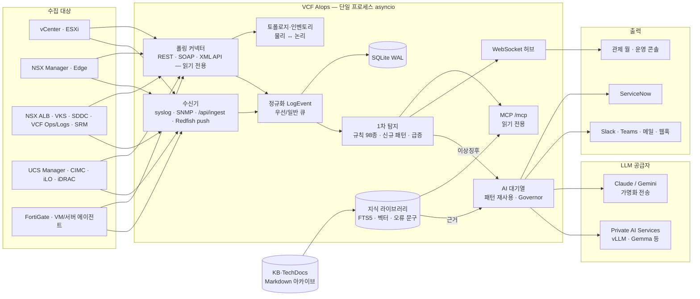

<div align="center">

# VCF AIops

**VMware Cloud Foundation 통합 관제 · 실시간 로그 이상탐지 · KB 근거 기반 Private AI 분석 포털**

vCenter·ESXi·NSX·NSX ALB(Avi)·VKS·SDDC Manager·VCF Operations·SRM·서버 BMC(UCS·iLO·iDRAC)·FortiGate·VM 게스트의 로그와 상태를
한 화면에 모으고, 규칙·통계로 이상을 추린 뒤 **사내 GPU의 LLM(VMware Private AI Services)** 과 **Broadcom KB·TechDocs 아카이브**를 근거로
원인과 명령 단위의 조치를 붙여 알립니다. 여기에 **정산(쇼백·차지백)·보안 판독(하드닝·KISA·VMSA/CVE)·용량 계획·VM 적정화**와
2.1 의 **MFA·OIDC SSO·SIEM(CEF) 전달·PagerDuty/Opsgenie 온콜·경영진 요약**까지 한 어플라이언스로 제공합니다.


[English](README.en.md) · [기능 명세](docs/FEATURES.md) · [운영 가이드](docs/GUIDE.md) · [변경 이력](CHANGELOG.md) · [Releases](../../releases)


<sub>NSX 도메인 탭에서 DOWN 된 Edge 를 누르면, AI 판정과 함께 원인 경로(FI › 섀시 › <b>장애 블레이드</b> › ESXi › Edge › T0)가 바로 보입니다.<br>
스크린샷은 모의 장비·테스트용 AI 응답·가상 KB 문서(990101 등, 사내 수집 아카이브 형식)로 찍었습니다.</sub>

</div>

---

## 목차

1. [한눈에 보기](#한눈에-보기)
2. [릴리스 노트](#릴리스-노트) — 2.1.0 변경 사항과 전체 버전 이력
3. [지원 기능 전체 목록](#지원-기능-전체-목록) — 영역별 기능 일람(도입 버전)
4. [설치 방법](#설치-방법) — 요구 사항 · 배포 파일 검증 · OVA · Ubuntu · 폐쇄망 · Windows · Docker · 업그레이드 · 첫 설정 · 제거
5. [왜 만들었나](#왜-만들었나)
6. [기능 상세](#기능-상세)
   - [수집](#1-수집) · [탐지](#2-탐지) · [AI 분석](#3-ai-분석) · [KB·TechDocs 지식 라이브러리](#4-kbtechdocs-지식-라이브러리) · [MCP 서버](#5-mcp-서버)
   - [통합 관제(NOC)](#6-통합-관제noc) · [운영 콘솔](#7-운영-콘솔) · [VM·서버 에이전트](#8-vm서버-에이전트) · [인시던트·조치·알림](#9-인시던트조치알림) · [플랫폼 운영](#10-플랫폼-운영)
   - [정산(Billing)](#11-정산billing) · [보안 판독(하드닝·KISA·VMSA/CVE)](#12-보안-판독하드닝kisavmsacve) · [용량 계획·VM 적정화](#13-용량-계획vm-적정화) · [vSAN Health](#14-vsan-health)
   - [MFA·SSO(OIDC)](#15-mfasso-oidc) · [SIEM·온콜 연동](#16-siem온콜-연동) · [경영진 요약](#17-경영진-요약)
7. [화면](#화면)
8. [아키텍처](#아키텍처)
9. [지원 대상](#지원-대상)
10. [설정](#설정)
11. [권한(RBAC)](#권한rbac)
12. [보안 설계](#보안-설계)
13. [패치·업그레이드](#패치업그레이드)
14. [API](#api)
15. [운영 명령](#운영-명령)
16. [문제 해결](#문제-해결)
17. [개발](#개발)
18. [문서](#문서)
19. [라이선스·오픈소스 고지](#라이선스오픈소스-고지)

## 한눈에 보기

| | |
|---|---|
| **모으기** | syslog(UDP/TCP/TLS) · SNMP 트랩 v1/v2c/v3 · HTTP 수집(Fluent Bit) · Redfish 이벤트 push/SSE · REST/SOAP/XML API 폴링 — 하나의 이벤트 모델로 정규화. 수집 계정은 **읽기 전용** |
| **추리기** | 탐지 규칙 **98종** + 신규 로그 패턴 + 발생량 급증(EWMA z-score), 같은 지문은 병합. 같은 로그 패턴은 AI 에 한 번만 |
| **설명하기** | 로컬 LLM(PAIS·vLLM, OpenAI 호환) · Claude · Gemini 작업별 라우팅. **KB 아카이브의 증상·원인·해결·우회 구역**과 운영 중인 버전을 근거로 원인·명령 순서 조치, 근거 없는 KB 번호는 '확인 필요' 표시 |
| **잇기** | 물리(패브릭 인터커넥트·섀시·블레이드) → 논리(ESXi·VDS·Edge·SE·**VM·Pod**·T0/T1·세그먼트·가상 서비스) 토폴로지와 **서비스 흐름도**(클라이언트 → VIP → SE → 풀 멤버 VM·Pod → ESXi → 서버)로 이상징후의 시작점과 영향 범위 |
| **따지기** | **정산** — VM 5분 표본 × 테넌트·프로젝트·요율표(사용률 가중), 월 명세서 · **보안 판독** — ESXi·vCenter 하드닝, KISA 가상화(HV-01~25), VMSA/CVE 버전 판독, **구성 변경 추적** |
| **내다보기** | **용량 계획** — 클러스터·데이터스토어 추세로 80%/90% 도달 예상일 · **VM 적정화** — 과다·과소·유휴·장기 꺼짐 VM 과 월 절감 추정 · **vSAN Health** 점검 결과·용량 효율 |
| **보여 주기** | 월 디스플레이용 관제(도메인 탭·전역 검색·개체 상세·패턴 묶음) + 운영 콘솔(실시간 로그·이상징후·인시던트·SLI·인벤토리) |
| **운영하기** | OVA 어플라이언스, Ed25519 서명 패치 웹 적용·롤백, AD/LDAP·RBAC·해시 체인 감사로그, 읽기 전용 MCP 서버 |

## 릴리스 노트

### 2.1.0 (현재) — 엔터프라이즈: 접근 통제 · 보안 연동 · 경영 가시성

| 구분 | 내용 |
|---|---|
| **MFA(TOTP)** | RFC 6238 2단계 인증(SHA1·6자리·30초, ±1 창) — 로컬·AD/LDAP·SSO 계정 공통. QR(SVG)·키 직접 입력 등록, 복구 코드 8개(1회용, 해시 저장), 코드 재사용 거부, `auth.mfa.required_roles` 로 역할별 필수화(등록 전 화면 사용 제한), 관리자 해제 |
| **OIDC SSO** | Authorization Code + PKCE(S256), id_token JWKS 서명 검증(RS·ES, `alg=none` 거부, 키 회전 대응), iss·aud·exp·nonce 검사, 그룹 클레임 → 역할 매핑. Keycloak·Entra ID·Okta·ADFS. SSO 뒤에도 MFA 적용 |
| **SIEM 전달** | 감사 로그·이상징후·인시던트를 ArcSight CEF 로 syslog(RFC 5424, UDP·TCP·TLS)에 실시간 전달 — Splunk·QRadar·ArcSight·Sentinel·Elastic |
| **온콜 채널** | PagerDuty(Events API v2, dedup_key) · Opsgenie(Alert API, alias, P1~P5) — 기존 Teams·Slack·웹훅·메일과 같은 내구성 발송함 |
| **API 토큰 IP 허용 목록** | 토큰별 IP/CIDR, 불일치 시 거부 + 감사 `ip_denied` |
| **경영진 요약** | `/noc/exec` — 30일 인시던트·SLA·MTTR/MTTA(전 30일 대비), 가용성·vSAN·용량 임박, 보안 판독, 이번 달 정산, 적정화 절감, 플랫폼 상태 |
| 새 의존성 | `segno` 1.6.6(BSD-3-Clause, MFA QR) — 패치 번들에 wheel 포함(폐쇄망 적용 가능) |
| 호환 | 1.3 이상·2.0 어플라이언스에 패치 한 번. 설정 변경 불필요(MFA 기본 '선택 등록', SSO·SIEM 기본 꺼짐) |
| 검증 | pytest 146개 통과 · 2.0.0 → 2.1.0 웹 패치 · 2.1.0 OVA 신규 부팅(QEMU, UEFI Secure Boot) |

**배포 파일(Releases)**

| 파일 | 크기 | SHA-256 |
|---|---|---|
| `vcf-aiops-2.1.0.ova` | 300MB | `94f5bd6df143fe26130450ba01f96cb2d4e7a6a270c81eecd9dd63e232b8132f` |
| `vcf-aiops-patch-2.1.0.tgz` | 36MB | `2ae5e39f8caceb37019a276f1aa7639e801b0b8d0d4a4121dc08f5e016a00292` |
| `SHA256SUMS` | — | 위 두 파일과 소스 압축의 해시 |

### 버전 이력

| 버전 | 주요 내용 |
|---|---|
| **2.1.0** | MFA(TOTP) · OIDC SSO · SIEM(CEF/syslog) 전달 · PagerDuty/Opsgenie · API 토큰 IP 허용 목록 · 경영진 요약 |
| **2.0.0** | 첫 메이저: vSAN Health(관리 API) · 용량 예측(80/90% 도달일) · VM 적정화(과다·과소·유휴·장기 꺼짐, 월 절감) · 구성 변경 추적 · 월간 경영 리포트 |
| 1.12.0 | VM·Pod 단위 논리 토폴로지 · 서비스 흐름도(VIP → 풀 멤버 → ESXi → 서버) · Avi 처리량·End user · vSAN 관제 도메인 · 정산(Billing) · 보안 판독(하드닝·KISA·VMSA/CVE) · 좌측 메뉴 묶음 |
| 1.11.4 | 이상징후·인시던트 KB 자동 연결, 지식 세대 재분석, 한국어 질문 영문 KB 검색 보완 |
| 1.11.3 | 첫 공개 정리 — Apache-2.0 · NOTICE · 제3자 고지 · 기능 명세 |
| 1.11.2 | 화면에서 KB·TechDocs md 파일·폴더·zip 올리기 |
| 1.11.1 | 삭제한 에이전트 재등록 차단 |
| 1.11.0 | 수집기 KB 아카이브 형식 · vCenter 9.1.1 이벤트 수정 · 에이전트 등록 삭제 · 스크롤 안정화 |
| 1.10.1 | NSX ALB VIP 트래픽 미수신 수정(테넌트별 메트릭) |
| 1.10.0 | KB·TechDocs 지식 라이브러리 · 근거 기반 답변 · MCP 서버 |
| 1.9.0 | 관제 전역 검색(Ctrl+K) · 개체 상세 · 패턴 묶음 |
| 1.8.0 | 관제 도메인 상세 탭(실시간 이벤트) |
| 1.7.0 | Cisco UCS · NSX Edge · Avi SE 수집 보강 · 물리→논리 토폴로지 |
| 1.6.0 | 관제 월 다중 페이지 · 동적 시각화 |
| 1.5.0 | AI 분석 구조 개편 · VM 이동/HA · 관제 고도화 |
| 1.4.0 | 커넥터 통합 · 모니터 · FortiGate 보안 · AI 분석 대기열 |
| 1.3.0 | 전체 인벤토리 · 서명 패치 |
| 1.2.0 | 토폴로지 · 관제 화면 · 인프라 점검 · 서버 BMC 호환 · 에이전트 |
| 1.1.0 | KO/EN · 계정 · VKS · 실시간 로그 |

버전별 상세 변경(내부 모듈·테이블·설정 키·테스트 수)은 [CHANGELOG.md](CHANGELOG.md).

## 지원 기능 전체 목록

각 항목의 자세한 설명은 [기능 상세](#기능-상세), 경로·권한은 [docs/FEATURES.md](docs/FEATURES.md). 괄호는 도입 버전입니다.

| 영역 | 기능 |
|---|---|
| **수집** | syslog UDP/TCP 514 · TLS 6514 · SNMP 트랩 v1/v2c/v3(USM) · HTTP 수집 `/api/ingest`(Fluent Bit, gzip) · Redfish 이벤트 push/SSE · API 폴링 커넥터 13종 · 제품 버전 자동 수집 · 수집 현황(수집 중/중단/오류/미수신) 감시·알림 · 단계별 연결 테스트(DNS→TCP→TLS→인증→엔드포인트) · 관리자 계정으로 **읽기 전용 수집 계정 자동 생성**(관리자 자격 증명 비보관) · ESXi 호스트 로그(hostd·vmkernel·vpxa) · VKS 자동 발견·파드 로그 |
| **탐지** | 규칙 98종(vSphere·vSAN·NSX·Avi·VKS·SDDC·BMC·FortiGate·Linux·Windows·Oracle·PostgreSQL·MySQL·SLI) · 신규 로그 패턴 · 발생량 급증(EWMA z-score) · 지문 병합 · 억제 정규식·사내 규칙 · 모니터(지표·로그 건수·무수신·커넥터·이상징후 임계, 그룹별 알림·음소거)(1.4) |
| **AI 분석** | 로컬 LLM(PAIS·vLLM 등 OpenAI 호환)·Claude·Gemini 작업별 라우팅·대체 · 패턴 재사용 · Governor(GPU 온도·대기열·시간당 상한) · 외부 전송 가명화 · 프롬프트 인젝션 경계 · 판정(요약·원인·명령 순서 조치·`[변경]` 표시·버전 경고) · 인시던트 RCA · AI 질의(`[R#]` 인용) · 근거 없는 KB 번호 '확인 필요' 표시 · AI 상황 브리핑 |
| **지식(KB·TechDocs)** | md 아카이브 증분 색인(폴더·NFS·SMB) · 화면 업로드(md·폴더·zip 4GB)(1.11.2) · 머리말 없는 KB 구역 추정 · BM25 + 식별자 + Dense(RRF) · 오류 문구 일치·제품·운영 버전·구역·문서 유형 가중 · 피드백 · 자동 연결·재분석(1.11.4) · 지식 공백 · 최근 갱신 KB · RAG 팩 · 형식 점검 CLI(1.10) |
| **MCP 서버** | `POST /mcp`(Streamable HTTP, JSON-RPC 2.0) — `knowledge_search`·`knowledge_get`·`open_anomalies`·`noc_status`, API 토큰(scope `read`)만, 읽기 전용(1.10) |
| **통합 관제(NOC)** | 종합 상황(도메인 슬롯·60분 타임라인·AI 브리핑) · 인프라 지도(vMotion/HA 애니메이션) · 물리·논리 토폴로지(FI→블레이드→ESXi→Edge/SE→**VM·Pod**→T0/T1·세그먼트)(1.12) · **서비스 흐름도**(1.12) · VIP 처리량·**End user**(1.12) · 이벤트·인시던트 · 보안(방화벽) · AI·플랫폼 · **경영진 요약**(2.1) · 도메인 상세 8종(vCenter·**vSAN**·NSX·NSX ALB·VKS·물리 서버·VM 게스트·보안) · 실시간 스트림·패턴 묶음 · 전역 검색(Ctrl+K)·개체 상세 · 자동 순환·키오스크 계정 · 위험 미확인 에스컬레이션 |
| **vSAN** | vSAN 로그·이벤트 전용 도메인 · 클러스터·디스크 그룹·호스트·데이터스토어 상태 · 비 vSAN 데이터스토어 구역(로컬·외장 SAN·NFS·vVols)(1.12) · **vSAN Health**(점검 결과·용량 효율·객체 상태, 변화 이벤트)(2.0) |
| **운영 콘솔** | 실시간 로그(필터·일시정지) · 이상징후 카드 · 인시던트 · 모니터 · 실시간 로그 보기(호스트별) · 인벤토리 · 토폴로지 · VM 이동·HA 이력 · VKS · 성능 SLI(CPU ready·메모리·디스크 지연·드롭 패킷, Failover Capacity) · 인프라 점검(vCheck) · 로그 전송 설정 점검 · SNMP 트랩 · KO/EN 전환 |
| **VM·서버 에이전트** | 등록(수집 토큰 + Linux Fluent Bit·rsyslog / Windows 설치 명령) · 무응답 감시·미설치 VM · 퇴역 · 등록 삭제·차단(1.11.1) |
| **인시던트·ITSM** | 토폴로지 상관 병합 · SLA(접수·해결)·MTTA/MTTR · 담당·상태·코멘트 · RCA · ServiceNow Table API / 일반 웹훅 연동 · 유지보수 창·사일런스 |
| **조치 게이트** | 미리보기 → 차단 사유 → 4-eyes 승인 → 재측정 → 실행, 쓰기 커넥터 별도 등록, 환경별 차단(prod 등) |
| **알림** | 대시보드·브라우저 알림 · Teams · Slack · 일반 웹훅 · SMTP · **PagerDuty · Opsgenie**(2.1) · 내구성 발송함(지수 백오프 재시도·채널 서킷 브레이커·실패함) · 쿨다운·최소 심각도 |
| **정산(Billing)** | VM 5분 표본 → 시간 누적 · 테넌트 › 프로젝트(클러스터·폴더·태그·VM 이름 매칭) · 요율표·버전(사용률 가중) · 보고서·CSV·월 명세서 · 테넌트 사용자 범위 제한(1.12) |
| **보안 판독** | ESXi·vCenter 하드닝 점검 · KISA 가상화 HV-01~25 대응표 · VMSA/CVE 버전 판독(NVD 동기화 선택·JSON 가져오기) · **구성 변경 추적**(2.0) · CSV·보고서(1.12) |
| **용량·적정화** | 클러스터 CPU·메모리, 공유 데이터스토어 추세 · 80/90% 도달 예상일 · N-1 메모리 여유 · VM 과다·과소·유휴·장기 꺼짐 · 회수 자원·월 절감 추정(2.0) |
| **리포트** | 일간·주간·**월간**(2.0)·기간 지정 HTML(인쇄 → PDF) · 정기 메일 · AI 요약 · 정산·용량·적정화·보안 판독 절 |
| **인증·접근 통제** | 로컬(PBKDF2) · AD/LDAP(LDAPS·StartTLS, 그룹→역할) · **OIDC SSO**(2.1) · **MFA(TOTP)**(2.1) · RBAC 4역할 · 유휴 10분·절대 만료 세션 · 실패 잠금·장기 미사용 잠금 · 비밀번호 정책·이력·만료 · 키오스크 계정 · CSRF·CSP·HSTS |
| **API·연동** | REST(OpenAPI `/api/docs`) · WebSocket · API 토큰(ingest·metrics·read, 만료·폐기, **IP 허용 목록**(2.1)) · Prometheus `/metrics` · **SIEM CEF 전달**(2.1) · MCP |
| **감사** | 로그인·설정·조치·AI 질의·업로드·삭제·명세서·판독 실행 기록 · SHA-256 해시 체인 무결성 검증 · 내보내기 · 보존 5년(기본) |
| **플랫폼** | 단일 프로세스 asyncio · 수신/처리/저장/화면 분리(write-behind) · 감독자(작업 재기동·하트비트) · systemd notify·워치독 · `/healthz`·`/readyz` · 플랫폼 자체 감시 · 선택 이중화(알림 리더 인계) · 야간 DB 백업 · 비밀값 암호화(Fernet/DPAPI) |
| **배포·패치** | OVA(Ubuntu 24.04, UEFI Secure Boot, vApp 속성 자동 구성) · Ubuntu 설치 스크립트·폐쇄망 번들 · Windows 서비스 · Docker · **Ed25519 서명 패치** 웹/CLI 적용·자동 백업·헬스 확인·자동 롤백 |

## 왜 만들었나

VCF 환경의 장애는 한 제품 안에서 끝나지 않습니다. 블레이드 하나의 POST 실패가 ESXi 장애로, 그 위 NSX Edge 의 DOWN 으로, 다시 Tier-0 북남 트래픽 중단으로 번집니다.
그런데 로그와 알람은 UCS Manager·vCenter·NSX·Avi 콘솔에 흩어져 있고, 하루 수백만 줄 가운데 진짜 신호는 몇 줄입니다. 신호를 찾은 뒤에도 "이 오류에 해당하는 KB 가 무엇이고, 우리 버전에 맞는 조치가 무엇인가"를 다시 찾아야 합니다.

VCF AIops 는 수집 → 선별 → 토폴로지 연결 → **KB 근거 기반 설명**을 한 흐름으로 묶어, 운영자가 "어디서 시작됐고, 무엇이 영향을 받고, 어떤 명령으로 고치는가"를 한 화면에서 보게 합니다.

## 기능 상세

### 1. 수집

| 경로 | 내용 |
|---|---|
| 수신기 | syslog UDP/TCP 514 · TLS 6514, SNMP 트랩 162(v3 USM 포함), `POST /api/ingest`(API 토큰 scope `ingest`, gzip), Redfish 이벤트 push(`/api/redfish/events/<토큰>`) |
| 폴링 커넥터 | vCenter(pyVmomi 이벤트·알람·인벤토리 + REST 헬스), SDDC Manager, NSX(Policy API 우선·Manager API 대체), NSX ALB(Avi, 전체 테넌트), VKS(k8s 이벤트 watch), VCF Operations·Logs·Automation, SRM, Cisco UCS Manager XML API, Redfish(iLO·iDRAC·XCC·CIMC), FortiGate REST |
| 버전 수집 | vCenter·ESXi·NSX·Avi·UCSM 버전을 자동 수집해 KB 적용 버전 판단·AI 문맥에 사용 |
| 수집 현황 | 소스별 수신량·마지막 수신·오류를 한 표로, '수집 중/중단/오류/미수신' 전환 알림 |
| 연결 테스트 | DNS → TCP → TLS(표준/구형) → 인증 → 엔드포인트별 응답을 단계별로 표시. 커넥터 점검 항목(예: '이벤트 해석', 'VIP 메트릭')에 원인과 HTTP 코드 |
| 호환성 | vCenter 9.x 의 SOAP 스키마 밖 관리 개체(ContentLibrary 등)를 보정해 이벤트를 잃지 않음(1.11.0), 구형 CIMC TLS 1.0, Avi 테넌트별 메트릭(1.10.1) |

### 2. 탐지

- **규칙 98종**: vSphere·vSAN·NSX·Avi·VKS·SDDC·서버 BMC·FortiGate, 게스트 OS(Linux 커널·파일시스템·OOM·스토리지·서비스 / Windows 41·6008·1001·7031·디스크·보안·클러스터·SQL Server), DB(Oracle ORA-·PostgreSQL·MySQL), 성능 SLI 위반.
- **신규 패턴**: 로그를 템플릿(숫자·주소·ID 가림)으로 바꿔 처음 보는 패턴을 표시. 기동 후 `warmup_seconds`(기본 5분)는 기준선 학습.
- **급증**: 패턴별 EWMA z-score.
- **병합**: 같은 지문(소스·패턴·호스트)은 한 이상징후로 묶고 횟수·최근 시각만 갱신. VM·서버·BMC 는 호스트별로 구분.
- 노이즈는 `detection.suppress` 정규식, 사내 시그니처는 `detection.extra_rules`.

### 3. AI 분석

| 항목 | 내용 |
|---|---|
| 공급자 | 로컬(VMware Private AI Services·vLLM 등 OpenAI 호환), Claude, Gemini — 작업별 라우팅(분석·RCA·질의), 장애 시 대체 |
| 비용·부하 조절 | 패턴 재사용(같은 패턴은 한 번만 분석), Governor(GPU 온도·대기열·시간당 호출 상한), 우선/일반 대기열 |
| 외부 전송 보호 | 외부 공급자에는 IP·호스트명을 **가명화**해 보내고 응답에서 복원. 장비 로그는 `[UNTRUSTED_LOG]` 경계로 격리(프롬프트 인젝션 방지) |
| 이상징후 판정 | 요약·이상 여부·심각도·추정 원인·조치 단계·근거 문서. 조치는 문서의 명령·메뉴 경로를 순서대로, 영향 큰 단계는 `[변경]` 표시, 적용 버전이 다르면 경고 |
| 근본원인 분석(RCA) | 인시던트 단위로 인과 사슬과 완결성 기준을 갖춘 보고 |
| AI 질의 | 판단 → 원인 → 조치 단계 → 적용 버전 → 참고 순서의 답변, `[R#]` 인용 링크, 운영 중 버전을 문맥에 포함 |
| 환각 방지 | 답변에 근거 문서에 없는 KB 번호가 있으면 '(근거 문서 없음 — 확인 필요)'로 표시하고 카드에 경고 |

### 4. KB·TechDocs 지식 라이브러리

Broadcom KB·TechDocs 를 Markdown 으로 수집한 아카이브를 색인해 AI 분석·RCA·AI 질의·관제 개체 상세의 근거로 씁니다(`app/knowledge.py`).

**넣는 방법** — `knowledge.paths` 폴더(NFS/SMB 마운트, 바뀐 파일만 주기적 증분 색인), 또는 화면에서 md 파일·폴더·zip 올리기와 끌어다 놓기(md 는 파일마다 즉시 색인, zip 은 기본 최대 4GB).

**사내 수집기 아카이브 형식(1.11.0)** — 아래 구조를 그대로 읽습니다.

```text
<아카이브>/
  README.md                          목차·수집 통계(색인 제외)
  _catalog/ _changes/ _rag/          수집기 메타 — '_'·'.' 로 시작하는 폴더는 항상 제외
  vmware/vsphere/kb/0430xxx/430250.md
  vmware/vcf/techdocs/<버전>/…/<문서>.md
  ca/ · symantec/ · other/           다른 Broadcom 사업부(순위 낮춤)
```

```yaml
---                                   # front matter 예(값은 예시)
source: kb                            # kb | techdocs
article_id: 430250
vendor: vmware
product: vsphere                      # 슬러그 → 제품(tanzu→vks, live-recovery→srm, cloud-director→vcd …)
products: [VMware vCenter Server]
doc_type: kb-troubleshooting          # 분석·RCA 가중
summary: ESXi hosts intermittently disconnect …   # 증상이 없으면 증상으로
error_signatures:                     # 로그 원문 정확 일치용
  - "SSL3_GET_RECORD:decryption failed or bad record mac"
updated: '2026-02-26'                 # '최근 갱신 KB'
url: https://knowledge.broadcom.com/external/article/430250
---
```

| 단계 | 처리 |
|---|---|
| 정리 | 제목 줄·`> Product:` 줄·끝의 `Yes`/`No` 피드백 꼬리·`CHANGE VERSION`·TechDocs 목차·아카이브 내부 링크 주소 제거 |
| 구역 | `## Symptoms/Cause/Resolution/Workaround/Environment` 같은 머리말이 있으면 그대로. **머리말 없는 KB**(수집 결과의 약 70%)는 KB 페이지 순서(Issue → Environment → Cause → Resolution → Workaround → Additional Information)와 제품명 줄 묶음(환경)을 경계로, 문장 단서(`To resolve`·`Fixed in`·`Broadcom recommends`·`Option 1` …)와 첫 단계(번호·코드·명령형 동사)로 원인/해결/우회를 나눔 |
| 메타 | KB 번호(3~7자리), 제품(슬러그·제품 목록·URL·본문), 적용 버전(front matter·TechDocs URL `8-0`·Environment 구역·`prior to 8.0 U3` 같은 문장), 문서 유형·요약·오류 문구 |
| 청크 | 구역 → 문단 경계 청크(코드 블록 보존, 겹침 꼬리는 단어 경계). 문서·청크·식별자는 SQLite FTS5, 벡터는 float16 memmap(선택) |

**검색 순위** — BM25 · 식별자 정확 일치(KB 번호·CVE·VMSA·`vob.*`·`esx.problem.*`·이벤트 ID) · Dense(임베딩 사용 시)를 RRF 로 합친 뒤:

| 신호 | 효과 |
|---|---|
| **오류 문구 일치** | `error_signatures` 의 고정 조각(숫자·주소·`<timestamp>` 제외)이 로그에 모두 있으면 ×1.6·관련도 100% |
| 제목 덮음 | 질의 단어를 제목이 많이 덮을수록 최대 ×1.35 |
| 소스 ↔ 제품 | 이벤트 소스(예: `nsx-edge`)와 같은 제품 ×1.2, 다른 제품 ×0.75 |
| 운영 버전 | 문서 적용 버전이 운영 중 버전과 겹치면 ×1.15, 아니면 ×0.85 |
| 의도별 구역 | 분석·질의 = 해결·우회, RCA = 원인 가중 |
| 문서 유형 | 문제 해결 ×1.1, 개념·릴리스 노트 ×0.85(분석·RCA) |
| 사업부·언어 | `vendors` 밖 ×0.7, `languages` 밖(일본어 번역본 등) ×0.8 |
| 피드백 | '도움됨/무관'은 같은 로그 패턴에만 반영 |

결과는 문서 단위로 묶고 같은 문서의 [증상]·[원인]·[해결]·[우회]·[환경]을 함께 붙입니다(부모 문서 확장, 문서당 기본 2,400자).

**자동 연결(1.11.4)** — 한국어 질문은 운영 용어 사전으로 영문 검색어를 덧붙이고(AI 질의는 사내 LLM 이 영문 검색어를 한 줄 더 생성), 근거 없이 판정된 이상징후에는 '관련 KB(자동)', 인시던트에는 묶인 이상징후의 근거·원문 로그를 합산한 '관련 KB·문서'가 붙습니다(RCA 근거로도 사용). 문서가 추가·변경되면 지식 세대가 올라가, 근거 없이 분석했던 패턴은 한 번 다시 분석하고 자동 연결도 다시 찾습니다.

**화면** — 좌측 **지식(KB·문서)**: 라이브러리 상태·zip 업로드·지금 색인/전체 재색인, 검색 시험(구역 칩·적용 버전·문서 유형·요약·피드백), 문서 전문(구역별·오류 문구), **지식 공백**(근거 없이 판정된 최근 7일 패턴과 수집할 키워드), **최근 갱신 KB**(14일, 운영 버전 '버전 일치'/'제품 일치', '우리 환경 해당만'), RAG 팩.

**측정(1.11.0)** — 아카이브 16,482개(98MB) → 청크 61,846개, 전체 색인 45초, DB 166MB, 질의 10–50ms(4 vCPU 개발 컨테이너·임베딩 없음).

| 질의(로그·질문) | 1위 결과 |
|---|---|
| `SSL3_GET_RECORD:decryption failed or bad record mac` | KB 430250 (오류 문구 일치) |
| `vLCM remediation stuck at 5% on ESXi host` | KB 430285 |
| `Precheck failed: com.broadcom.vcfa.upgrade.90.application.check.test-application-01-9x-fips` | KB 447667 · 446198 (FIPS 사전 점검 두 KB) |

형식 점검: `python -m app.knowledge inspect <폴더> --n 10` — 파일별 종류·KB·제품·버전·구역, 마지막에 구역 추정·오류 문구·번역본 건수와 구역별 보유 문서 수.

### 5. MCP 서버

`POST /mcp`(Streamable HTTP, JSON-RPC 2.0, 프로토콜 2025-06-18). 인증은 **API 토큰(scope `read`)만** 허용하고 브라우저 세션 쿠키는 받지 않습니다. 도구는 모두 읽기 전용입니다.

| 도구 | 설명 |
|---|---|
| `knowledge_search(query, source?, k?)` | 라이브러리 + RAG 팩 검색 — KB 번호·적용 버전·구역·원문 링크 |
| `knowledge_get(doc_id)` | `lib:<번호>` 문서 전문(구역별) |
| `open_anomalies(source?, limit?)` | 미확인 이상징후와 AI 판정·근거 |
| `noc_status()` | 관제 도메인별 상태·사유 |

문서·로그 텍스트는 `<untrusted_document>` 로 감싸 반환합니다.

### 6. 통합 관제(NOC)

| 페이지 | 내용 |
|---|---|
| 종합 상황 `/noc` | 도메인 슬롯(장애/주의/정상·사유), 60분 타임라인, 이벤트 흐름, AI 상황 브리핑, 슬롯 포커스·필터 |
| 인프라 지도 `/noc/infra` | 클러스터·호스트·VM, vMotion/HA 이동 애니메이션과 피드 |
| 물리·논리 토폴로지 `/noc/topology` | FI → 섀시 → 블레이드 → ESXi → VDS → Edge·SE·**VM(정확한 이름)** → **Pod** → Edge 클러스터·SE 그룹 → T0·VS → T1·**세그먼트·포트그룹**, 장애 경로 강조. VM·Pod 표시 수 선택(호스트당·노드당·전부) |
| **서비스 흐름도**(같은 페이지 탭, 1.12) | 클라이언트 → VIP(가상 서비스) → Service Engine → 풀 → 풀 멤버(VM·Pod, IP 로 자동 연결) → 세그먼트 → Tier-1·Tier-0 → ESXi → 물리 서버. VIP·VM 이름으로 조회, End user 분석의 상위 클라이언트로 펼침 |
| **VIP 상세**(종합 상황 'VIP 트래픽' 카드) | **처리량**(대역폭·수신/송신 바이트·패킷·신규/완료/끊긴 연결·2xx/4xx/5xx·SSL·지연·Apdex) · **End user**(애플리케이션 로그 표본: 고유 클라이언트·상위 IP·OS·브라우저·기기·위치·응답 코드·URI·도메인·지연 p95/p99) · **풀 멤버** |
| 이벤트·인시던트 · 보안 · AI·플랫폼 | 전체 스트림·인시던트, FortiGate 공격 요약, AI 대기열·공급자·GPU |
| **vSAN** `/noc/d/vsan` | vSAN 관련 로그·이벤트만(실시간·패턴·중요·이상징후·인시던트) + vSAN 클러스터(**vSAN Health 전체·장애/주의 점검 수·중복제거 비율·객체 상태**)·**vSAN Health 점검 표**·호스트/디스크 그룹·데이터스토어·알람, **아래 별도 구역: vSAN 이 아닌 데이터스토어**(로컬 디스크·외장 SAN·NFS·vVols) |
| **도메인 상세** `/noc/d/<id>` | vCenter·vSAN·NSX·NSX ALB·VKS·물리 서버·VM 게스트·보안 — 상태, 심각도 추이, 개체 타일, 도메인 전용 표(예: Avi 가상 서비스의 테넌트·메트릭), **빠짐없는 실시간 스트림**, **패턴 묶음**(같은 로그 수천 줄을 한 줄로) |

- **전역 검색(Ctrl+K 또는 /)** 으로 호스트·VM·Edge·VS 이름을 찾아 **개체 상세 드로어**(상태·최근 이벤트·이상징후·토폴로지 경로·관련 KB 해결 발췌)로 바로 이동.
- 월 디스플레이: `?rotate=60` 자동 순환, 키오스크 계정(조회 전용), 단축키(`?`).
- 노트북처럼 낮은 화면(높이 900px 이하)에서는 고정 배치 대신 페이지 스크롤로 전환(1.11.0).

### 7. 운영 콘솔

- **실시간 대시보드**: 로그 스트림(소스·등급·문자열 필터, 일시정지, 위로 올려 읽는 동안 위치 유지) + 이상징후 카드(AI 판정·근거 KB·관련 문서·확인 처리).
- **인시던트**: 토폴로지 기반 묶음, SLA·MTTA/MTTR, RCA, ServiceNow 연동.
- **성능 SLI**: VM 4대 경합 지표(CPU ready·메모리 latency·디스크 latency·dropped packets) 점수·밴드, 클러스터 KPI, Failover Capacity.
- **VKS**, **인프라 점검(vCheck)**, **인벤토리**, **VM 이동 이력**, **보안(방화벽)**, **로그 전송 설정 점검**, **SNMP 트랩**, **AI 질의**, **리포트**, **시스템·패치**, **사용자·토큰**, **감사로그**.
- 서랍은 Esc 로 닫히고, 좌측 메뉴는 낮은 화면에서도 스크롤됩니다(1.11.0).
- 좌측 메뉴 묶음(1.12): **관제**(대시보드·통합 관제·인시던트·모니터·실시간 로그) · **인프라·워크로드**(인벤토리·토폴로지·VM 이동·VKS·성능 SLI·인프라 점검) · **보안·컴플라이언스**(보안 판독·방화벽) · **비용·리포트**(정산·리포트) · **AI·지식** · **수집·연동**(수집 현황·커넥터·로그 전송·에이전트·SNMP) · **시스템·관리**(플랫폼 상태·패치·설정·사용자·감사로그).

### 8. VM·서버 에이전트

| 기능 | 내용 |
|---|---|
| 등록 | 콘솔 › VM·서버 에이전트 › 에이전트 등록 → 수집 전용 토큰 + Linux(Fluent Bit·rsyslog)·Windows 설치 명령. 설치 스크립트가 서버·토큰을 먼저 시험 |
| 무응답 감시 | 로그·하트비트가 `agents.stale_seconds`(300초) 없으면 경보 → 복구 시 자동 확인. 미설치 VM(vCenter 전원 켜진 VM 대비) 표시 |
| 퇴역 | 무응답 감시에서만 제외, 기록 유지(다시 수신되면 자동 복귀) |
| **등록 삭제·차단(1.11.1)** | 행 '삭제' 또는 '퇴역 N건 삭제'·'무응답 N건 삭제' — 목록·DB 에서 지우고 **차단 목록**에 넣어, 다시 보내도 등록·저장하지 않음. '삭제·차단한 호스트' 표에 이후 수신 시도·보낸 주소·경로(Fluent Bit·rsyslog·ESXi vmx)와 제거 방법, '차단 해제' |
| 실시간 로그 보기 | `/#tail/<호스트>` — 서버측 필터로 그 호스트 로그를 빠짐없이, 최근 1시간 불러오기 |

### 9. 인시던트·조치·알림

- 알림: Slack·Teams·메일·웹훅, 심각도·소스·유지보수 창·사일런스, 근거 KB 와 적용 버전 표시.
- ITSM: ServiceNow 인시던트 생성·갱신, 포털 링크(`public_url`).
- **조치 게이트**: 미리보기 → 차단 사유 → 4-eyes 승인 → 재측정 → 실행. 조치는 **쓰기 권한 커넥터를 별도로** 등록해야 동작(수집 커넥터는 읽기 전용).

### 10. 플랫폼 운영

- 단일 프로세스 asyncio, 수신 → 큐 → 처리 → 저장(write-behind) → 화면(클라이언트별 송신 큐) 분리 — 어느 한쪽이 느려도 수집 지속.
- systemd `Type=notify` + 워치독, `/healthz`·`/readyz`, Prometheus `/metrics`, 플랫폼 자체 감시.
- 선택 이중화(액티브/스탠바이, 알림 리더 인계), 야간 DB 백업, KO/EN 화면 전환.
- **리포트**: 일간·주간·**월간(2.0)**·기간 지정 HTML(브라우저 인쇄 → PDF), 정기 메일, AI 요약. 주간·월간·기간 리포트에는 **정산 합계·용량 예측·VM 적정화·보안 판독** 절이 붙어 경영 보고에 그대로 쓸 수 있습니다.

### 11. 정산(Billing)

VM 사용량을 vCenter 인벤토리에서 **5분마다 표본**(전원·vCPU·메모리·할당 디스크·CPU/메모리 사용률)으로 남겨 테넌트·프로젝트별 비용을 계산합니다. 별도 수집기·DB 없이 기존 읽기 전용 vCenter 커넥터를 씁니다.

| 항목 | 내용 |
|---|---|
| 프로젝트 매칭 | 클러스터 · VM 폴더(경로 접두, 하위 포함) · 태그(`카테고리:태그` 또는 태그) · VM 이름 — 하나라도 맞으면 포함(OR). 겹치면 VM 이름 > 태그 > 폴더(긴 경로) > 클러스터, 같으면 프로젝트 번호가 작은 쪽. 시간마다 그 시각의 위치·태그로 매칭(이동 이력 반영) |
| 비용 | 켜진 5분 블록마다 `(vCPU × vCPU 단가 + 메모리 GB × GB 단가 + 할당 디스크 GB × GB 단가) × 5/60`. 꺼진 블록은 미과금(요율표에서 디스크만 과금 선택). 사용률 가중(vCPU·메모리): `가중치 = 최소 + (1 − 최소) × 사용률` |
| 요율표 | 테넌트·프로젝트별 지정(없으면 기본 요율표). 단가 변경은 '적용 시작일' 버전으로 쌓여 지난 기간은 이전 단가로 계산 |
| 보고서 | 이번 달·7일·30일·월·기간 지정 — 테넌트 › 프로젝트 › VM(켜진 시간·평균 vCPU/메모리/디스크·사용률·항목별 비용), 미할당 VM, CSV, **월 명세서**(인쇄 → PDF) |
| 테넌트 사용자 | 테넌트에 계정을 지정하면 그 계정(관리자 제외)은 자기 테넌트 보고서만 조회 |
| 보관 | 시간 단위 누적 `billing.retention_days`(400일) — 5분 정산과 같은 결과를 1/12 행 수로 |

### 12. 보안 판독(하드닝·KISA·VMSA/CVE)

연결된 vCenter 에서 **읽기 전용**(속성 읽기·`QueryOptions`, System.Read)으로 설정을 모아 판독합니다. 설정은 바꾸지 않습니다.

| 항목 | 내용 |
|---|---|
| 하드닝 | ESXi 고급 설정(Shell·DCUI·Host Client 타임아웃, 계정 잠금, 비밀번호 복잡성·이력·기간, 원격 syslog, MOB, BPDU 차단, TPS salting, execInstalledOnly, 구 TLS, 로그인 배너), 서비스(SSH·ESXi Shell·SLP·CIM·SNMP·NTP), 방화벽 기본 차단·허용 IP, 잠금 모드, 표준 vSwitch·분산 포트그룹 보안 정책, VM 고급 설정(복사·붙여넣기·장치 연결·원격 콘솔·VMX 정보 크기), 오래된 스냅샷, 꺼진 VM, Tools — 항목마다 기대값·현재값·조치 |
| KISA 대응표 | KISA 주요정보통신기반시설 가상화 점검 HV-01~25 로 묶어 항목별 판정. 호스트 로컬 계정·백업 정책처럼 vCenter 경유로 볼 수 없는 항목은 '수동 확인' |
| VMSA/CVE | 실행 중인 ESXi·vCenter 버전/빌드와 취약점 목록을 비교 — 권고에 고정 빌드가 있으면 **취약/조치됨**, NVD CPE 의 버전·업데이트만 일치하면 **가능(빌드 확인)**. 목록은 NVD CVE API 2.0 동기화(`assessment.nvd`, 프록시·API 키) 또는 폐쇄망용 JSON 가져오기(NVD 응답 · 이 프로젝트 `advisories` 형식) |
| 결과 | 준수율·미흡·VMSA 취약 요약, 버전 현황, CSV, 인쇄 보고서(PDF), 24시간 자동 점검·최근 30회 이력 |
| **변경 추적(2.0)** | 지난 점검과 비교해 호스트 추가/제거, ESXi·vCenter 버전/빌드, 고급 설정, 서비스, 잠금 모드, NTP, 방화벽, vSwitch·분산 포트그룹 보안 정책, VM 고급 설정 변경과 **판정 악화/개선**을 표시. 변경은 이벤트(소스 vcenter·종류 config)로 남고, 보안 관련 변경·악화는 경고로 올라가 이상징후·인시던트가 됩니다 |

### 13. 용량 계획·VM 적정화

좌측 **용량·적정화**. 별도 수집 없이 vCenter 커넥터 표본(5분)과 정산 표본을 씁니다.

| 항목 | 내용 |
|---|---|
| 용량 예측 | 클러스터 CPU·메모리, 공유 데이터스토어(vSAN·FC/iSCSI VMFS·NFS·vVols) 사용률을 시간 단위로 누적(400일). 최근 30일 일 평균에 최소제곱 직선을 맞춰 **하루 증가율(%/일)·80%/90% 도달 예상일·30/90일 뒤 사용률**, 데이터스토어 GB/일, **N-1 호스트 메모리 여유**(HA). 90일 안에 90% 도달·80% 이상은 주의, 90% 이상은 위험 |
| VM 적정화 | 최근 14일 켜진 시간 기준 — **과다**(vCPU ≥ 4·피크 CPU < 25% 또는 메모리 ≥ 8GB·피크 < 30% → 권장 = 피크 × 1.5, 최소 2), **과소**(평균 CPU ≥ 75% 또는 메모리 ≥ 85%), **유휴**(피크 CPU < 3%·메모리 < 10%), **장기 꺼짐**(7일 이상). 회수 가능 vCPU·메모리·디스크와 기본 요율표 기준 **월 절감 추정**. 임계값은 `capacity.*` |
| 내보내기 | CSV, 월간 리포트 절 |

피크는 '시간 평균의 최댓값'이라 순간 피크보다 낮게 나옵니다. 권장 크기를 적용하기 전 성능 SLI(CPU ready)와 애플리케이션 특성을 함께 보세요.

### 14. vSAN Health

vCenter 의 vSAN 관리 API(`/vsanHealth`)를 pyvmomi 내장 바인딩으로 호출합니다(별도 SDK 없음, 읽기 전용 System.Read).

| 항목 | 내용 |
|---|---|
| Health | 클러스터 전체 상태(green·yellow·red), 분류(네트워크·물리 디스크·데이터·클러스터·용량·HCL …)별 개별 점검 결과·정상/전체 개체 수·방치 시 위험 — 통합 관제 vSAN 도메인 'vSAN Health 점검' 표 |
| 용량 | 전체·여유·사용률, 중복제거/압축 논리·물리 용량과 비율, 객체 유형별 사용 |
| 객체 | 상태별 객체 수(healthy·reduced availability …) |
| 이벤트 | 점검 결과가 바뀌면 red=오류·yellow=경고·정상 복귀=정보 이벤트 → 이상징후·인시던트·알림 |
| 버전 | `/sdk/vsanServiceVersions.xml` 로 가장 높은 vsan.version 을 쓰고 미지원이면 후보로 내려감. vSAN 이 없는 vCenter(vcsim 포함)는 조용히 건너뜀. 끄려면 커넥터 `vsan_health: false` |

### 15. MFA·SSO (OIDC)

| 항목 | 내용 |
|---|---|
| MFA(TOTP) | RFC 6238 TOTP(SHA1·6자리·30초, ±1 창) — 로컬·AD/LDAP·SSO 계정 공통. 사용자 메뉴 '2단계 인증(MFA)'에서 QR(순수 파이썬 `segno`) 또는 키 직접 입력으로 등록, 확인 코드 1회 통과 뒤 **복구 코드 8개**(해시만 저장, 1회용)를 한 번만 표시. 같은 코드 재사용 거부(마지막 사용 창 기록) |
| 로그인 2단계 | 등록된 계정은 아이디·비밀번호 통과 뒤 세션 없이 `mfa_token`(5분, 5회 오류 시 폐기)만 받고 `POST /api/auth/mfa/verify` 로 코드(또는 복구 코드)를 내야 세션 쿠키가 발급됩니다. SSO 로그인도 같은 2단계를 거칩니다 |
| 필수 역할 | `auth.mfa.required_roles: [admin]` — 해당 역할은 등록 전까지 `/api/auth/*` 외 API 가 403(`mfa_enroll`)이고 콘솔이 등록 창을 바로 띄웁니다. 관리자는 사용자 목록에서 분실 계정의 MFA 를 '해제'(감사 기록) |
| SSO(OIDC) | Authorization Code + **PKCE(S256)** · state·nonce 를 HMAC 서명 쿠키(10분)에 보관 · id_token 은 IdP JWKS 로 **RS256/ES256 서명 검증**(alg=none·HS 거부, 키 회전 시 JWKS 1회 재조회) · iss·aud·exp·nonce 확인. Keycloak·Entra ID·Okta·ADFS 등 `/.well-known/openid-configuration` 을 제공하는 IdP |
| 역할 매핑 | `role_claim`(기본 `groups`, 중첩은 `realm_access.roles`) 값 ↔ `group_role_map`(가장 높은 역할), 없으면 `default_role`(비우면 거부). 그룹이 userinfo 에만 있는 IdP(Okta)는 자동 보완. 사용자는 `source=oidc` 로 upsert, 역할은 로그인마다 재계산 |
| 운영 | 로그인 화면 'SSO 로그인' 버튼(`display_name`), 역방향 프록시 뒤는 `redirect_base`, 관리자 점검 `POST /api/auth/oidc/test`(메타데이터·JWKS·콜백 URL) |

<p align="center"> </p>

### 16. SIEM·온콜 연동

| 항목 | 내용 |
|---|---|
| SIEM(CEF) | 감사 로그(인증·설정·조치·사용자)·이상징후(최소 심각도 이상)·인시던트 생성/상태 변경을 **ArcSight CEF** 로 만들어 **syslog(RFC 5424) UDP·TCP·TLS** 로 보냅니다 — Splunk·QRadar·ArcSight·Sentinel·Elastic 공통. `CEF:0|Broadcom|VCF AIops|<버전>|<signature>|<name>|<0~10>|suser= src= externalId= cs1Label=…` 형식, 이스케이프 규칙 준수 |
| 내구성 | 비동기 큐 5,000건(넘치면 오래된 것부터 버리고 유실 수 집계), TCP/TLS 는 연결 끊기면 5초 뒤 재연결하며 미발송분 유지, 상태(보냄·대기·유실·마지막 오류)는 설정 화면·경영진 요약·`GET /api/settings/siem/status` |
| 설정 | 운영 설정 › **SIEM 전달** 탭(저장 즉시 적용, '테스트 전송'은 저장 전 값으로 CEF 1건 발송 후 샘플 표시) 또는 `siem.*` |
| PagerDuty | 알림 채널 형식 `pagerduty` — Events API v2 `trigger`, `routing_key`=키, `dedup_key=aiops-<이상징후 id>`(재발은 같은 인시던트), severity critical/error/warning/info 매핑, `custom_details` 에 본문·인시던트·재발 수 |
| Opsgenie | 형식 `opsgenie` — Alert API, `GenieKey` 헤더, `alias=aiops-<id>`(중복 제거), 우선순위 P1(critical)·P2(error)·P3(warning)·P5(info), 태그(소스·분류) |
| 기존 채널 | Teams·Slack·일반 JSON 웹훅·SMTP 는 그대로이며 모든 채널이 같은 발송함(outbox: 지수 백오프 재시도·채널 서킷 브레이커·실패함)을 씁니다 |

<p align="center"></p>

### 17. 경영진 요약

`/noc/exec`(관제 월 탭 '경영진 요약', 콘솔 좌측 메뉴) — 경영진·서비스 오너용 한 장짜리 현황, 60초 갱신, 자동 순환에 포함.

| 구역 | 내용 |
|---|---|
| 상단 KPI | 열린 인시던트(위험 수·30일 생성·전 30일 대비 증감), SLA 위반, **MTTR·MTTA**, 호스트 가용(n/m·클러스터·VM 전원·유지보수), vSAN 클러스터(장애·주의·사용률·점검 실패), 90일 내 **용량 90% 도달 임박** 수 |
| 추세 | 인시던트·이상징후 일별 30일 막대, 심각도 분포 |
| 열린 인시던트 | 심각도 순 상위 8건(상태·담당·생성 시각) |
| 보안 판독 | 하드닝 준수율 링, 점검 실패·주의·통과, CVE 취약·가능·CRITICAL, 구성 변경·악화·개선, 운영 중인 제품 버전/빌드 |
| 이번 달 정산 | 월초~현재 합계(통화), 테넌트별 비용 막대, 미배정 VM 수 |
| 용량·적정화 | 90% 도달 임박 클러스터·데이터스토어(일수), 과다 할당·유휴·장기 꺼짐 VM, 회수 가능 vCPU·메모리, 월 절감 추정 |
| 플랫폼 | 수집 문제, AI 분석 상태, 알림 발송(대기·실패함), SIEM 전달(보냄·대기·유실) |

<p align="center"></p>

## 화면

| | |
|:-:|:-:|
| <br>**종합 상황** — 도메인 슬롯·60분 타임라인·AI 상황 브리핑 | <br>**물리·논리 토폴로지** — FI → 블레이드 → ESXi → Edge/SE → T0/VS |
| <br>**도메인 상세 · 패턴** — 같은 로그 수천 줄을 한 줄로 | <br>**전역 검색(Ctrl+K)** — 이름으로 바로 개체 상세 |
| <br>**인프라 지도** — 클러스터·호스트·VM, vMotion/HA 이동 표시 | <br>**운영 콘솔** — 실시간 로그 + AI 판정 이상징후 |
| <br>**지식 라이브러리** — 로그 원문이 오류 문구와 맞아 KB 990101(가상) 1위, 증상·원인·해결·우회 구역 | <br>**문서 전문** — 머리말 없는 KB 를 구역으로 추정해 표시 |
| <br>**최근 갱신 KB** — 운영 중인 버전과 겹치는 문서를 위로 | <br>**근거 기반 AI 판정** — 원인에 KB 인용, 조치는 문서 명령 순서대로 |
| <br>**논리 토폴로지(1.12)** — VM 이름·Pod·세그먼트까지 | <br>**서비스 흐름도** — VIP → SE → 풀 멤버 VM → ESXi → 서버 |
| <br>**VIP 처리량** — 바이트·패킷·연결·응답 코드·SSL·지연 | <br>**VIP End user** — 상위 클라이언트·OS·브라우저·위치 |
| <br>**vSAN 관제** — vSAN 로그·상태 + 비 vSAN 데이터스토어 | <br>**정산** — 테넌트 › 프로젝트 › VM 비용 |
| <br>**보안 판독** — 하드닝·KISA·VMSA/CVE | <br>**KISA 대응표** — HV-01~25 |
| <br>**용량 예측(2.0)** — 추세·80/90% 도달 예상일·N-1 여유 | <br>**VM 적정화(2.0)** — 과다·과소·유휴·장기 꺼짐, 월 절감 |
| <br>**vSAN Health(2.0)** — 분류별 점검 결과·방치 시 위험 | <br>**변경 추적(2.0)** — 지난 점검 이후 구성 변경·판정 악화 |
| <br>**경영진 요약(2.1)** — 인시던트·SLA·MTTR·가용성·정산·보안 한 장 | <br>**MFA 등록(2.1)** — QR·복구 코드, SSO(OIDC)·SIEM(CEF) 전달 |

## 아키텍처



- **단일 프로세스**: 514/162 수신기, 이상징후·WebSocket 상태가 메모리에 있어 워커를 늘리지 않습니다. I/O 는 asyncio, 무거운 추론은 GPU 서버가, 지식 색인은 스레드가 맡습니다.
- **느린 쪽이 전체를 막지 않음**: LLM·DB·브라우저 어느 하나가 느려져도 수집은 계속됩니다. 상세는 [운영 가이드 9장](docs/GUIDE.md#9-실시간안정성-설계).

## 지원 대상

| 커넥터 `type` | 대상 | 방식 | 권장 권한 |
|---|---|---|---|
| `vcenter` | vCenter Server 8.x/9.x(9.1.1 포함), ESXi | pyVmomi(SOAP) 이벤트·알람·인벤토리 + REST 헬스 | Read-only + 이벤트/알람 조회 |
| `sddc` | SDDC Manager | REST `/v1/tokens` | 읽기 전용 |
| `nsx` | NSX 4.x/9.x Manager·Edge | Policy API 우선, Manager API 대체 | Auditor |
| `avi` / `nsx-alb` | NSX Advanced Load Balancer | REST(페이지 200·전체 테넌트, 테넌트별 메트릭) | read-only |
| `vks` / `kubernetes` | Supervisor · 워크로드 클러스터 | k8s API 이벤트 watch·노드·파드 | view(ServiceAccount) |
| `vcfops` · `vcflogs` · `vcfa` · `srm` | VCF Operations · Logs · Automation · SRM | REST | ReadOnly |
| `ucsm` | Cisco UCS Manager(B-Series·FI) | XML API `/nuova` | UCSM 로컬 사용자 read-only 역할 |
| `redfish` / `ilo` / `idrac` | 서버 BMC(UCS C-Series CIMC·HPE·Dell·Lenovo) | Redfish 이벤트·부품 상태, 구형 CIMC XML | 로그인(조회) |
| `fortigate` | FortiGate | syslog + REST | 읽기 전용 API 관리자 |

읽기 전용 수집 계정 만들기는 [docs/ACCOUNTS.md](docs/ACCOUNTS.md), 커넥터 편집 화면의 **관리자 계정으로 수집 전용 계정 만들기**(관리자 비밀번호는 저장하지 않고 생성 비밀은 한 번만 표시)를 참고하세요.

## 설치 방법

### 0) 요구 사항

**사양(배포 크기)** — 원본 로그 보존 7일 기준. 보존 기간을 늘리면 데이터 디스크를 비례해 키웁니다.

| 크기 | vCPU | 메모리 | 데이터 디스크 | 규모 |
|---|---|---|---|---|
| 소(Small) | 4 | 8GB | 60GB | PoC·관리 도메인, 평균 ~100 EPS |
| **중(Medium, 기본)** | 8 | 16GB | 250GB | VI 도메인 1~2개, 평균 ~500 EPS |
| 대(Large) | 8 | 32GB | 700GB | 다수 도메인·VM 에이전트, 평균 ~1,500 EPS |

OS 디스크는 OVA 에 포함(씬 프로비저닝). LLM 은 별도(VMware Private AI Services·vLLM 등 OpenAI 호환 엔드포인트) — 없으면 규칙 탐지만 동작합니다.

**지원 플랫폼**

| 방식 | 대상 |
|---|---|
| OVA | vSphere(ESXi) 7.0 이상 — 가상 하드웨어 vmx-17, EFI + 보안 부팅, PVSCSI·VMXNET3 |
| 직접 설치 | Ubuntu 24.04 LTS(x86_64), Python 3.12 |
| Windows | Windows Server(x64) — Miniforge(conda) 환경에 Python 3.12, WinSW 서비스 |
| 컨테이너 | Docker Engine + Docker Compose v2(`docker-compose.yml` 동봉) |

**네트워크(방화벽)**

| 방향 | 포트 | 용도 |
|---|---|---|
| 수신 | 8630/tcp(변경 가능) | 웹 콘솔·관제·REST·WebSocket·MCP·에이전트 HTTPS·Redfish push |
| 수신 | 514/udp·tcp · 6514/tcp | syslog · syslog TLS(ESXi·NSX·Avi·SDDC·FortiGate·rsyslog) |
| 수신 | 162/udp | SNMP 트랩 |
| 수신 | 22/tcp | SSH(어플라이언스, 끌 수 있음) |
| 송신 | 443/tcp | vCenter·SDDC Manager·NSX·Avi·VCF Operations/Logs/Automation·SRM·UCSM·BMC·FortiGate API, k8s API(6443) |
| 송신 | LLM 포트 | PAIS/vLLM(예: 443), 외부 공급자 사용 시 해당 주소 |
| 송신(선택) | 514/6514 · 443 | SIEM syslog · 웹훅/PagerDuty/Opsgenie · NVD(보안 판독, 기본 꺼짐) |
| 송신 | 123/udp | NTP — 수집 대상과 **같은 NTP** 필수(시각 상관 분석) |

DNS 정방향·역방향 레코드와 수집 대상과 같은 NTP 를 먼저 준비하세요. 수집용 **읽기 전용 계정**은 [docs/ACCOUNTS.md](docs/ACCOUNTS.md) 또는 커넥터 화면의 '관리자 계정으로 수집 전용 계정 만들기'로 만듭니다.

### 1) 배포 파일 받기·검증

GitHub [Releases](../../releases) 에서 OVA·패치·`SHA256SUMS` 를 받습니다. 저장소 웹 업로드(파일당 25MB) 때문에 `*.partNN` 조각으로 받은 경우 합친 뒤 반드시 해시를 확인합니다.

```powershell
# Windows — 조각·SHA256SUMS·Join-Parts.ps1 을 같은 폴더에 두고(번호 순 병합 → 크기 → SHA-256 대조, 종료 코드 0/1)
powershell -ExecutionPolicy Bypass -File .\Join-Parts.ps1            # -DeleteParts: 통과 후 조각 삭제 · -Force: 해시 다른 기존 파일 재생성
```

```bash
# Linux·macOS
cat vcf-aiops-2.1.0.ova.part* > vcf-aiops-2.1.0.ova
cat vcf-aiops-patch-2.1.0.tgz.part* > vcf-aiops-patch-2.1.0.tgz
sha256sum -c SHA256SUMS --ignore-missing         # macOS: shasum -a 256 -c SHA256SUMS
```

`Join-Parts.ps1` 은 저장소 `scripts/windows/Join-Parts.ps1` 에도 있습니다.

### 2) OVA 어플라이언스(권장)

1. vSphere Client › 클러스터(또는 호스트) › **OVF 템플릿 배포** › `vcf-aiops-2.1.0.ova`
2. **배포 구성**: 소 / 중(기본) / 대
3. **스토리지**: 씬 프로비저닝 권장, **네트워크**: 수집 대상에 닿는 포트그룹
4. **템플릿 사용자 지정(vApp 속성)**

| 분류 | 속성 | 설명 |
|---|---|---|
| 네트워크 | `net.hostname` | FQDN(필수) |
| | `net.ip` · `net.prefix` · `net.gateway` | 고정 IP(비우면 DHCP — 운영은 고정 IP 권장) |
| | `net.dns` · `net.search` | DNS 서버·검색 도메인(쉼표 구분) |
| | `net.ntp` | NTP(쉼표 구분) — ESXi·vCenter·NSX 와 같은 서버 |
| 시스템 | `sys.password` | OS 관리자 `aiopsadmin` 비밀번호(12자 이상, 첫 SSH 로그인 때 변경 강제) |
| | `sys.ssh_key` · `sys.ssh` | SSH 공개 키(선택) · SSH 사용 여부 |
| | `sys.timezone` · `sys.firewall` | 시간대(기본 Asia/Seoul) · ufw(22·웹 포트·514·6514·162 만 허용) |
| 애플리케이션 | `app.admin_password` | 웹 콘솔 `admin` 초기 비밀번호(첫 로그인 때 변경 강제) |
| | `app.port` | 웹·API 포트(기본 8630) |
| | `app.pais_url` · `app.pais_key` · `app.llm_model` | PAIS(OpenAI 호환) 주소·키·모델 id(`GET /v1/models` 의 id 와 정확히 일치) — 비우면 규칙 탐지만 |
| | `app.retention_days` | 원본 로그 보존(일, 기본 7) |
| | `app.snmp_community` | SNMP 트랩 커뮤니티(v3 는 설치 후 설정) |
| | `app.cert_pem` · `app.key_pem` | 사내 CA 서버 인증서·키(base64 한 줄, 선택 — 비우면 자체 서명) |

5. 전원을 켜면 첫 부팅에 네트워크·데이터 디스크·인증서·방화벽·서비스가 자동 구성되고 VM 콘솔에 `Status : READY` 가 표시됩니다(약 2~4분).
6. `https://<FQDN>:8630` 접속 → `admin` / vApp 에 넣은 초기 비밀번호 → 새 비밀번호로 변경.

CLI 배포 예:

```bash
ovftool --acceptAllEulas --powerOn --deploymentOption=medium --name=vcf-aiops \
  --datastore=<데이터스토어> --network=<포트그룹> \
  --prop:net.hostname=aiops.corp.example --prop:net.ip=10.10.20.50 --prop:net.prefix=24 \
  --prop:net.gateway=10.10.20.1 --prop:net.dns=10.10.0.11 --prop:net.ntp=10.10.0.1 \
  --prop:sys.password='<OS 비밀번호>' --prop:app.admin_password='<웹 초기 비밀번호>' \
  --prop:app.pais_url=https://pais.corp.example/v1 --prop:app.pais_key='<PAIS 키>' \
  vcf-aiops-2.1.0.ova 'vi://<사용자>@<vCenter>/<데이터센터>/host/<클러스터>'
```

배포 뒤 확인: `ssh aiopsadmin@<FQDN>` → `sudo vcf-aiopsctl status` · `vcf-aiopsctl ovf`(입력한 vApp 속성, 비밀값 가림) · `vcf-aiopsctl provision-log`. 상세: [docs/OVA.md](docs/OVA.md)

### 3) Ubuntu 24.04 직접 설치

```bash
tar xzf vcf-aiops-2.1.0-source.tar.gz && cd vcf-aiops
sudo bash scripts/linux/install.sh --fqdn aiops.corp.example --ntp 10.10.0.1 \
  --pais-url https://pais.corp.example/v1 --pais-key '<PAIS 키>' --enable-firewall
vcf-aiopsctl status
sudo cat /var/lib/vcf-aiops/initial-admin.txt     # 웹 admin 초기 비밀번호(확인 후 삭제)
```

| 옵션 | 설명 |
|---|---|
| `--fqdn` · `--port` | 서버 이름(인증서 SAN) · 웹 포트(기본 8630) |
| `--cert` · `--key` | 사내 CA 인증서·키(PEM) — 없으면 자체 서명 생성 |
| `--ntp` | NTP 서버(chrony) |
| `--pais-url` · `--pais-key` · `--llm-model` | LLM 엔드포인트·키·모델 id |
| `--retention-days` · `--snmp-community` | 원본 로그 보존 · SNMP 커뮤니티 |
| `--enable-firewall` | ufw 활성화(필요 포트만 허용) |
| `--offline <폴더>` | 폐쇄망 번들로 설치 |
| `--upgrade` | 기존 설치 갱신(설정·데이터 유지) |

설치 위치: 프로그램 `/opt/vcf-aiops` · 설정 `/etc/vcf-aiops`(`config.yaml`·`.env`·`secret.key`) · 데이터 `/var/lib/vcf-aiops` · 서비스 `vcf-aiops`(systemd, 사용자 `aiops`). 상세: [docs/INSTALL-UBUNTU.md](docs/INSTALL-UBUNTU.md)

### 4) 폐쇄망(오프라인) 설치

```bash
# 인터넷이 되는 Ubuntu 24.04 PC 에서 번들 만들기(Python wheel · python3-venv 등 .deb · 프로그램 · Fluent Bit)
bash vcf-aiops/scripts/linux/build-offline.sh --with-agents     # → /tmp/vcf-aiops-offline.tar.gz
# 대상 서버로 옮긴 뒤
tar xzf vcf-aiops-offline.tar.gz -C /tmp
sudo bash /tmp/vcf-aiops-offline/vcf-aiops/scripts/linux/install.sh --offline /tmp/vcf-aiops-offline \
  --fqdn aiops.corp.example --ntp 10.10.0.1
```

OVA 는 필요한 패키지를 모두 포함하므로 폐쇄망에서 그대로 배포됩니다. 패치 번들도 의존 패키지 wheel 을 포함합니다.

### 5) Windows Server

```powershell
# 관리자 PowerShell, 소스를 C:\vcf-aiops 에 푼 뒤
cd C:\vcf-aiops
.\scripts\windows\setup.ps1 -InstallMiniforge -DisableSnmpTrapService   # Python 환경·의존 패키지·방화벽 규칙
.\scripts\windows\service.ps1 install                                    # Windows 서비스 등록·시작(워치독 포함)
.\scripts\windows\service.ps1 status                                     # restart | stop | start | logs | uninstall
```

| `setup.ps1` 옵션 | 설명 |
|---|---|
| `-InstallMiniforge` / `-MiniforgeInstaller <exe>` | Miniforge 설치(폐쇄망은 미리 받은 설치 파일 지정) |
| `-DisableSnmpTrapService` | Windows 기본 SNMP Trap 서비스 중지(162/udp 충돌 방지) |
| `-SkipFirewall` | 방화벽 규칙 생략 |
| `-DefenderExclusion` · `-HighPerformancePower` | data·logs 실시간 검사 제외 · 전원 '고성능'(지연 감소) |

비밀값은 DPAPI 로 암호화됩니다. `service.ps1 install -Account LocalService` 로 최소 권한 계정 실행.

### 6) Docker / 데모

```bash
cp config.example.yaml config.yaml && cp .env.example .env     # .env 에 PAIS_BASE_URL·PAIS_API_KEY 등
docker compose up -d --build          # :8630, 514/udp·tcp, 6514/tcp, 162/udp
docker compose logs -f

# 장비 없이 화면 확인(합성 로그)
pip install -r requirements.txt
AIOPS_DEMO=1 python -m app.serve
```

### 7) 업그레이드(패치)

| 현재 | 방법 |
|---|---|
| 1.3 이상 어플라이언스·설치본, 2.0.x | 웹 콘솔 › **시스템·패치** › `vcf-aiops-patch-2.1.0.tgz` 업로드 → 서명·무결성·버전 확인 → 적용(프로그램·DB 자동 백업 → 교체 → 기동 확인 → 실패 시 자동 롤백) · 또는 `sudo vcf-aiopsctl patch vcf-aiops-patch-2.1.0.tgz` |
| 1.2 이하 | `tar xzf vcf-aiops-patch-2.1.0.tgz && sudo bash vcf-aiops-patch-2.1.0/apply.sh` |
| Docker | 새 소스로 `docker compose up -d --build`(볼륨 데이터 유지) |
| 되돌리기 | 시스템·패치 › '이전 버전으로 되돌리기' 또는 `sudo vcf-aiopsctl rollback` |

새 테이블·열은 첫 기동 때 자동 생성되며 설정 변경은 필요 없습니다. 자세한 내용은 [패치·업그레이드](#패치업그레이드).

### 8) 설치 후 첫 설정

| 순서 | 위치 | 할 일 |
|---|---|---|
| 1 | 로그인 | 초기 비밀번호 변경 · 사용자 메뉴 › **2단계 인증(MFA)** 등록(관리자는 `auth.mfa.required_roles: [admin]` 권장) |
| 2 | 수집·연동 › **커넥터** | vCenter·SDDC·NSX·Avi·VKS·VCF Ops·UCSM·BMC·FortiGate 추가(읽기 전용 계정) → **연결 테스트** |
| 3 | 수집·연동 › **로그 전송 설정** | ESXi·NSX·Avi·SDDC 의 syslog 대상이 이 서버를 가리키는지 점검(누락 표시) |
| 4 | 운영 설정 › **AI 분석** | LLM 공급자·모델·작업별 라우팅, 외부 공급자 가명화 확인 |
| 5 | AI·지식 › **지식(KB·문서)** | KB·TechDocs md 아카이브 경로 지정 또는 zip 업로드 |
| 6 | 운영 설정 › **알림 채널·인시던트·ITSM·SIEM** | Teams/Slack/메일/PagerDuty/Opsgenie, SLA, ServiceNow, SIEM(CEF) |
| 7 | 사용자·토큰 | AD/LDAP·SSO(OIDC) 매핑, 운영자 계정, 연동 토큰(허용 IP) |
| 8 | 비용·리포트 | 정산 테넌트·프로젝트·요율표, 정기 리포트 수신자, 야간 백업 |
| 9 | 관제 월 | `/noc?rotate=60` 키오스크 계정(`auth.kiosk_users`)으로 표시 |

### 9) 접속 주소·포트

| 주소·포트 | 용도 |
|---|---|
| `https://<서버>:8630/` | 운영 콘솔(웹·REST·WebSocket 단일 포트) |
| `https://<서버>:8630/noc` | 통합 관제(월 디스플레이), `?rotate=60` 자동 순환 |
| `https://<서버>:8630/noc/d/<도메인>` | 도메인 상세(`vc` `vsan` `nsx` `avi` `vks` `srv` `vmg` `sec`) |
| `https://<서버>:8630/mcp` | MCP 서버(API 토큰 scope `read`) |
| `/healthz` · `/readyz` · `/api/docs` · `/metrics` | 헬스체크 · 준비 상태 · OpenAPI · Prometheus |
| 514/udp·tcp, 6514/tcp, 162/udp | syslog · syslog TLS · SNMP 트랩 |

### 10) 제거

```bash
sudo bash /opt/vcf-aiops/scripts/linux/uninstall.sh            # 프로그램·서비스 제거(설정·데이터 유지)
sudo bash /opt/vcf-aiops/scripts/linux/uninstall.sh --purge    # 설정·데이터·계정까지 삭제(되돌릴 수 없음)
```

Windows: `.\scripts\windows\service.ps1 uninstall` · Docker: `docker compose down`(볼륨까지 지우려면 `-v`) · OVA: VM 삭제.

## 설정

설정은 `config.yaml`(구조)과 `.env`(비밀값)로 나뉘며, 대부분은 화면(운영 설정)에서 바꾸고 즉시 반영됩니다. 화면에서 저장한 비밀값은 암호화되어 `********` 로만 표시됩니다.

```yaml
llm:
  base_url: ${PAIS_BASE_URL}            # OpenAI 호환 /v1 (VMware Private AI Services, vLLM 등)
  api_key: ${PAIS_API_KEY}
  model: google/gemma-4-31B-it          # /v1/models 의 id 와 일치
  # providers:                          # 선택: 외부 공급자 추가
  #   - {name: claude, type: anthropic, api_key: "${ANTHROPIC_API_KEY}", model: claude-haiku-5-5}
  #   - {name: gemini, type: gemini, api_key: "${GEMINI_API_KEY}", model: gemini-3.5-flash-lite}
  # routing: {analyze: local, rca: claude, chat: claude}
  external_mask: true                   # 외부 전송 시 IP·호스트명 가명화
  pattern_reuse: true                   # 같은 패턴은 한 번만 분석
  governor: {temp_pause: 80, temp_resume: 72, max_calls_per_hour: 120}

connectors:
  - {type: vcenter, name: vc-m01, host: vc-m01.example.local, username: svc-aiops-ro@vsphere.local, password: "${VC_MGMT_PASS}"}
  - {type: nsx,     name: nsx-m01, host: nsx-m01.example.local, username: svc-aiops-ro, password: "${NSX_PASS}"}
  - {type: ucsm,    name: ucs-a,   host: ucs-fi-vip.example.local, username: aiops-ro, password: "${UCSM_PASS}"}
```

### KB·TechDocs 지식 라이브러리

```yaml
knowledge:
  paths: [/mnt/kb-archive]       # 수집기 아카이브 루트(하위 전체). 바뀐 파일만 증분 색인
  scan_interval: 21600           # 6시간
  top_k: 4                       # 이상징후 1건당 근거 문서 수
  min_relevance: 0.4
  max_chars_per_ref: 2400        # 문서 1건이 AI 에 들어가는 최대 글자
  vendors: [vmware]              # 우선 사업부 — ca·symantec·other(비 VMware)는 ×0.7
  languages: [en, ko]            # 일본어 번역본 등은 ×0.8
  skip_dirs: []                  # 추가 제외 폴더(_catalog·_changes·_rag 는 항상 제외)
rag:
  embedding: {enabled: true, base_url: "${EMBED_BASE_URL}", model: BAAI/bge-m3}   # 선택: 하이브리드 검색
```

```bash
python -m app.knowledge inspect /mnt/kb-archive --n 10      # 우리 md 형식이 잘 읽히는지 미리 확인
```

화면(좌측 **지식(KB·문서)**)에서는 **md 파일 올리기**(여러 개 선택)·**폴더 올리기**(하위 구조 유지)·**zip 묶음 올리기**·**끌어다 놓기**로 넣을 수 있습니다. md 파일은 올리는 즉시 색인돼 KB 번호·제품·버전·구역이 결과 표에 바로 나오고, 같은 경로는 덮어씁니다(KB 갱신). 수천 개 이상은 zip 이 빠릅니다. 상세: [운영 가이드 14장](docs/GUIDE.md#14-kbtechdocs-지식-라이브러리--mcp)

### MCP(Claude Desktop·사내 에이전트)

운영 설정 › 사용자·토큰에서 API 토큰(scope `read`)을 발급한 뒤 MCP 클라이언트에 Streamable HTTP 서버로 등록합니다(예: Claude Code 의 `.mcp.json`).

```json
{"mcpServers": {"vcf-aiops": {"type": "http", "url": "https://aiops.example.local:8630/mcp",
  "headers": {"Authorization": "Bearer aiops_xxxxxxxx"}}}}
```

전체 항목은 [config.example.yaml](config.example.yaml) 과 [운영 가이드](docs/GUIDE.md)를 참고하세요.

## 권한(RBAC)

| 권한 | 조회자 | 감사자 | 운영자 | 관리자 | 대상 |
|---|:-:|:-:|:-:|:-:|---|
| `view` | ● | ● | ● | ● | 관제·콘솔 조회, 지식 검색 |
| `audit.view` | | ● | | ● | 감사로그 |
| `operate` | | | ● | ● | 확인 처리·재분석·인시던트·사일런스·리포트·연결 테스트·지식 피드백·정산/용량 즉시 표본·보안 판독 실행 |
| `action.request` | | | ● | ● | 조치 요청 |
| `action.approve` | | | | ● | 조치 승인(4-eyes) |
| `settings` | | | | ● | 커넥터·알림·규칙·지식·RAG 팩·유지보수 창·백업·**에이전트 퇴역·삭제**·정산 테넌트/프로젝트/요율·취약점 목록 |
| `users` · `system` | | | | ● | 사용자·토큰(허용 IP)·**MFA 해제** · 패치 업로드·적용·롤백 |

경로별 권한은 `app/security/auth.py` 의 `ROUTE_RULES`(첫 일치)이며, 규칙에 없는 `/api/*` 는 GET=view, 그 외=settings 가 안전 기본값입니다. 키오스크 로그인과 scope `read` 토큰은 조회자 권한입니다.

## 보안 설계

| 원칙 | 구현 |
|---|---|
| 수집은 읽기 전용 | 모든 수집 커넥터는 조회 권한 계정 전제. 조치 기능은 쓰기 계정 커넥터를 **별도로** 등록해야 동작하며 4-eyes 승인을 거칩니다 |
| 관리자 자격 증명 비보관 | 수집 계정 생성(프로비저닝)에 쓴 관리자 자격 증명은 저장하지 않고, 생성된 비밀은 한 번만 표시 |
| 비밀값 암호화 | Windows DPAPI / 그 외 Fernet. 화면·로그·감사 기록에서 마스킹 |
| 외부 AI 최소 노출 | 외부 공급자에는 IP·호스트명을 가명화해 전송, 응답에서 복원. 장비 로그는 `[UNTRUSTED_LOG]`, MCP 응답 문서는 `<untrusted_document>` 경계 |
| MCP | API 토큰(scope `read`)만, 세션 쿠키 불가, 쓰기 도구 없음 |
| 업로드 | 지식 zip 은 스트리밍 저장·크기 제한, 경로 탈출(zip slip)·md 외 파일 거부 |
| 패치 무결성 | 번들 매니페스트를 **Ed25519 로 서명**, 어플라이언스가 root 권한으로 검증 후 적용. 서명 개인 키는 저장소·이미지에 포함하지 않고 오프라인 보관 |
| 접근 통제 | AD/LDAP·**OIDC SSO(PKCE, JWKS 서명 검증)** + RBAC, **MFA(TOTP, 역할별 필수·복구 코드)**, 유휴 10분 세션, 로그인 5회 실패 시 30분 잠금, CSRF·CSP·HSTS |
| API 토큰 | SHA-256 해시 저장·만료일·범위(ingest·metrics·read)에 더해 **허용 IP/CIDR 목록**(토큰별, 불일치는 감사 `ip_denied`) |
| SIEM | 감사·이상징후·인시던트를 CEF/syslog(TLS 가능)로 외부 SIEM 에 실시간 전달 — 어플라이언스 밖에 위변조 불가한 사본 |
| 감사 | 로그인·설정 변경·조치·AI 질의·에이전트 삭제·정산 명세서·보안 판독 실행까지 기록, 행마다 직전 해시를 포함한 SHA-256 체인 |
| 외부 통신(선택) | 보안 판독의 NVD 동기화만 외부(services.nvd.nist.gov)로 나가며 **기본 꺼짐** — 보내는 값은 제품 CPE 문자열뿐(호스트명·IP 없음). 폐쇄망은 JSON 가져오기 |

취약점 제보는 [SECURITY.md](SECURITY.md)를 참고하세요.

## 패치·업그레이드

```bash
# 빌드(서명 키는 저장소 밖, 기본 ~/.vcf-aiops/patch-signing.key)
bash appliance/patch/build-patch.sh --version 2.1.0 --out ./out

# 적용: 웹 콘솔 › 시스템·패치 › 업로드 → 서명·무결성·버전 확인 → 적용(자동 백업·헬스 확인·실패 시 롤백)
sudo vcf-aiopsctl patch vcf-aiops-patch-2.1.0.tgz
```

**1.x·2.0 → 2.1.0**: 패치 한 번으로 올라갑니다(1.3 이상 어플라이언스, 번들에 `segno` wheel 포함 — 폐쇄망도 가능). 새 테이블(`bill_usage`·`cap_usage`·`assess_*`·`mfa`, `api_tokens.allow_ips` 열)은 첫 기동 때 자동 생성되고 설정 변경은 필요 없습니다(MFA 는 기본 '선택 등록', `auth.mfa.required_roles` 로 필수화). 1.10.x 이하에서 올리면 지식 라이브러리 색인 스키마가 바뀌어 첫 기동 때 한 번 전체 재색인합니다(16,482개 기준 약 45초). 정산·용량 표본은 패치 직후부터 쌓이므로 추세·적정화는 각각 7일·1일 뒤부터 나옵니다.

OVA 빌드: `bash appliance/build-ova.sh --version 2.1.0 --out ./out` (Ubuntu 24.04 빌드 머신). 상세: [docs/PATCH.md](docs/PATCH.md)

## API

브라우저는 세션 쿠키 + `X-Requested-With: aiops` 헤더, 외부 연동은 API 토큰(`Authorization: Bearer aiops_…`, scope `ingest`·`metrics`·`read`)을 씁니다. 전체 목록은 `/api/docs`.

| 경로 | 설명 |
|---|---|
| `GET /api/noc` · `/api/noc/kpi` · `/api/noc/brief` | 관제 슬롯 집계 · 상단 지표 · AI 상황 브리핑 |
| `GET /api/noc/domain/{id}` · `/events` · `/patterns` | 도메인 상세 · 호스트별 이벤트 · 패턴 묶음 |
| `GET /api/noc/entity?sid=&name=` · `/api/noc/search?q=` | 개체 상세 · 전역 검색 |
| `GET /api/topology/stack?vm_limit=&pod_limit=` · `GET /api/topology/flow?vs=&vm=` | 물리 → 논리 스택 토폴로지(VM·Pod) · 서비스 흐름도 |
| `GET /api/avi/vips` · `GET /api/avi/vips/{uuid}/endusers?minutes=` | VIP 처리량 메트릭 · End user 집계 |
| `GET /api/billing/report` · `/report.csv` · `/statement?tenant=&month=` · `/config` · `POST/PUT/DELETE /api/billing/tenants·projects·rates` | 정산 보고서 · CSV · 월 명세서 · 설정 |
| `GET /api/assessment` · `/report.csv` · `/report.html` · `POST /api/assessment/run` · `/advisories/import` · `/advisories/sync` | 보안 판독 결과(변경 추적 포함) · 보고서 · 실행 · 취약점 목록 가져오기·NVD 동기화 |
| `GET /api/capacity?days=` · `/api/capacity/rightsizing?days=` · `/report.csv` · `POST /api/capacity/sample` | 용량 예측 · VM 적정화 · CSV · 즉시 표본 |
| `POST /api/reports/generate {kind: daily|weekly|monthly|custom}` | 리포트 생성(월간은 정산·용량·적정화·보안 판독 절 포함) |
| `GET /api/knowledge` · `/search` · `/doc/{id}` · `/gaps` · `/recent` | 라이브러리 상태 · 검색 · 문서 전문 · 지식 공백 · 최근 갱신 KB(`days`·`mine`) |
| `PUT /api/knowledge/file` · `PUT /api/knowledge/upload` · `POST /reindex` · `POST /feedback` | md 파일 한 개 올리기(즉시 색인, `X-Filename`·`X-Relpath`·`?collection=`) · zip 업로드 · 색인 · 피드백 |
| `POST /mcp` | MCP(Streamable HTTP) |
| `GET /api/agents` · `DELETE /api/agents/{host}[?purge=true&block=true]` · `POST /api/agents/purge` · `DELETE /api/agents/blocks/{host}` | 에이전트 목록(차단 목록 포함) · 퇴역/등록 삭제·차단 · 일괄 삭제 · 차단 해제 |
| `GET /api/anomalies` · `POST /api/anomalies/{id}/ack` | 이상징후 · 확인 처리 |
| `GET/POST /api/incidents…` | 인시던트·RCA·ITSM |
| `POST /api/ingest` | 외부 로그 수집 |
| `WS /ws` | 실시간 스트림(snapshot → logs·anomaly·status·incident·tail) |
| `GET /metrics` | Prometheus |

## 운영 명령

```bash
vcf-aiopsctl status | health | logs [줄] | ports | version
vcf-aiopsctl restart | stop | start
vcf-aiopsctl backup                 # 온라인 일관 백업(sqlite3 .backup)
vcf-aiopsctl support                # 지원 번들(비밀값 제외)
vcf-aiopsctl reset-admin [사용자] [--generate]
vcf-aiopsctl ovf | provision-log    # 어플라이언스 vApp 속성·첫 부팅 로그
sudo vcf-aiopsctl patch <번들.tgz> | rollback | patch-history
```

## 문제 해결

| 증상 | 원인 · 조치 |
|---|---|
| vCenter 점검 '이벤트 해석: warn … expected type vim.ManagedEntity, but got vim.ContentLibrary' | vCenter 9.1.1 의 새 관리 개체를 pyVmomi 가 몰라 그 이벤트 묶음을 버리던 문제 → **1.11.0 에서 수정**. 패치 후 다음 수집에서 경고가 사라지고 `ok — SOAP 스키마 밖 형식 보정: ContentLibrary` 로 표시 |
| NSX ALB VIP 트래픽 0 b/s · '수집 대기' | 다른 테넌트의 VS 메트릭을 admin 컨텍스트로만 조회 → 1.10.1 에서 테넌트별 조회. 남으면 도메인 상세 › 가상 서비스 표의 '메트릭' 열과 점검 'VIP 메트릭'의 HTTP 코드 확인 |
| 삭제한 에이전트가 다시 나타남 | 1.11.0 은 등록만 지워 전송이 살아 있으면 재등록됨 → **1.11.1 에서 삭제 = 차단**. '삭제·차단한 호스트' 표의 보낸 주소·경로로 남은 전송(Fluent Bit·rsyslog·ESXi vmx 로그 설정)을 찾아 제거 |
| 정산 비용이 비어 있음 | 요율표가 없으면 사용량만 집계 — 정산 › 요율표에서 추가(첫 요율은 지난 표본에도 적용). VM 이 '미할당'이면 프로젝트 조건(폴더 경로·태그 이름) 확인 — 태그는 vCenter REST 세션이 있어야 수집(커넥터 점검의 'VM 태그') |
| VIP End user 가 비어 있음 | VS 분석 정책에서 클라이언트 로그(전체 로그는 full client logs)가 꺼져 있으면 애플리케이션 로그가 없음 — 처리량 탭은 메트릭으로 계속 표시 |
| 보안 판독 VMSA 가 '목록 비어 있음' | NVD 동기화(`assessment.nvd.enabled`·`proxy`) 또는 보안 판독 › 취약점 목록 › JSON 가져오기 후 '지금 점검' |
| 용량 예측이 '수집 중' | 표본 7일 미만 — 표본은 자동으로 쌓이며(5분) 7일 뒤 추세가 나옵니다. 로컬 디스크는 대상이 아닙니다 |
| vSAN Health 결과 없음 | 커넥터 점검의 'vSAN Health' 항목 확인 — `/vsanHealth` 연결 실패(방화벽·443)나 pyvmomi 8.0.3 미만이면 사유가 표시됩니다. vSAN 이 꺼진 클러스터는 대상 아님 |
| 관련 KB 가 안 붙음 | 1.11.4 에서 수정 — KB 를 올리기 전에 분석된 패턴은 지식이 바뀌면 한 번 다시 분석하고, 근거 없는 이상징후·인시던트에는 '관련 KB(자동)' 이 붙습니다. 지식 화면의 '자동 연결' 줄에서 건수 확인. 그래도 없으면 `python -m app.knowledge inspect` 로 형식 점검, 지식 공백의 키워드로 아카이브 보강 |
| 같은 KB 의 일본어판이 위에 뜸 | `knowledge.languages` 에서 우선 언어 확인(기본 en·ko) |
| 화면이 위로 스크롤되지 않음 | 1.11.0 에서 화면 틀이 밀리는 문제·낮은 화면에서 메뉴가 잘리는 문제 수정. 브라우저 캐시를 비우고(Ctrl+F5) 다시 확인 |

## 개발

```text
app/
  connectors/      vCenter·NSX·Avi·VKS·UCSM·Redfish·FortiGate·syslog·SNMP … (vmomi_compat.py: pyVmomi 9.x 호환 보정)
  engine.py        수집 입구 · 큐 · 탐지 · 이상징후 · WebSocket 플러시
  detect.py        규칙 98종·신규 패턴·급증 탐지
  llm.py · aiqueue.py · aigov.py · aipatterns.py   AI 분석·대기열·조절·패턴 재사용
  knowledge.py · rag/ · mcp_server.py                KB·TechDocs 라이브러리(아카이브 파서·구역 추정·오류 문구·순위) · RAG 팩 · MCP 서버
  agents.py        VM·서버 에이전트 레지스트리(무응답·퇴역·삭제)
  noc.py · stack.py · topology.py · inventory.py    관제 집계 · 물리↔논리 토폴로지·서비스 흐름도 · 인벤토리
  vsan.py · connectors/vsanhealth.py                 vSAN 관제 집계 · vSAN Health API 클라이언트
  billing.py · capacity.py · assess.py               정산 · 용량 예측/VM 적정화 · 보안 판독·변경 추적(api_*.py 가 라우터)
  static/          운영 콘솔(index.html) · 관제 월(noc*.html/js/css) · core.js(세션·모달·스크롤 보호) · i18n
appliance/         OVA 빌드 · 첫 부팅 프로비저닝 · 서명 패치
scripts/           Linux·Windows 설치·서비스 스크립트
deploy/            에이전트(Fluent Bit·rsyslog) · VKS 매니페스트
tests/             pytest(139개)
```

```bash
pip install -r requirements.txt -r requirements-dev.txt
python -m pytest -q                       # vcsim(127.0.0.1:8989)이 있으면 vCenter 프로비저닝 경로까지
```

- 화면 문구는 한국어가 원문이며 `app/static/i18n-en.js` 사전으로 영어 전환(KO/EN)됩니다. 새 문구는 사전에 함께 추가합니다.
- 장비 없이 개발할 때는 `demo.enabled: true`(합성 로그)와 vCenter 시뮬레이터(govmomi `vcsim`)를 함께 쓰면 편합니다.
- 화면 틀을 움직이는 `scrollIntoView` 대신 `AIOPS.reveal(el)`(가장 가까운 스크롤 상자만 이동)을 씁니다.

## 문서

| 문서 | 내용 |
|---|---|
| [docs/FEATURES.md](docs/FEATURES.md) | **기능 명세** — 전체 기능, API 180개·탐지 규칙 98종·모니터·조치 카탈로그 목록 |
| [docs/GUIDE.md](docs/GUIDE.md) | 운영 가이드(배포 구조·커넥터별 API·탐지·AI·알림·API·실시간 설계·용량·지식 라이브러리) |
| [docs/OVA.md](docs/OVA.md) | OVA 배포·vApp 속성·첫 부팅 |
| [docs/INSTALL-UBUNTU.md](docs/INSTALL-UBUNTU.md) | Ubuntu 설치 A–Z(망분리·인증서·이중화·백업) |
| [docs/PATCH.md](docs/PATCH.md) | 서명 패치 빌드·적용·롤백 |
| [docs/ACCOUNTS.md](docs/ACCOUNTS.md) | 읽기 전용 수집 계정 |
| [CHANGELOG.md](CHANGELOG.md) | 버전별 변경 이력 |
| [SECURITY.md](SECURITY.md) | 보안 정책·취약점 제보 |

## 라이선스·오픈소스 고지

VCF AIops 는 [Apache License 2.0](LICENSE) 으로 배포합니다. 저작권·상표 고지는 [NOTICE](NOTICE) 에 있습니다.

| 문서 | 내용 |
|---|---|
| [THIRD_PARTY_NOTICES.md](THIRD_PARTY_NOTICES.md) | 포함·설치·실행 중 사용하는 제3자 구성요소 전체와 라이선스(Python 런타임 34개, 저장소 동봉 WinSW·Pretendard, OVA 의 govc·OS 패키지, 설치 시 내려받는 Fluent Bit·Miniforge, 개발 전용) |
| [THIRD_PARTY_LICENSES.txt](THIRD_PARTY_LICENSES.txt) | 라이선스 원문 — Python 런타임 패키지 34개(각 패키지 동봉 원문), govc, WinSW, Pretendard(OFL 1.1) |
| [docs/OSS-APPLIANCE-PACKAGES.md](docs/OSS-APPLIANCE-PACKAGES.md) | OVA 에 들어 있는 Ubuntu 24.04 패키지 262개와 소스 제공 안내 |

카피레프트 구성요소: ldap3(LGPL-3.0, 수정 없이 별도 모듈로 사용), certifi(MPL-2.0, 수정 없음), OVA 의 GPL·LGPL OS 패키지(Ubuntu 공식 바이너리, 수정 없음 — 소스 제공 안내는 위 문서). LLM 모델 가중치와 Broadcom KB 원문은 포함하지 않습니다.

- 의존성이 바뀌면 `scripts/third_party.py` 로 `THIRD_PARTY_LICENSES.txt` 를 다시 만듭니다.
- This product uses the NVD API but is not endorsed or certified by the NVD.

---

<sub>VMware, VMware Cloud Foundation, vSphere, NSX, Avi 는 Broadcom Inc. 의 상표이며, Cisco UCS·Fortinet/FortiGate 등은 각 소유자의 상표입니다.
이 프로젝트는 Broadcom·VMware 의 공식 제품이 아니며 지원 대상이 아닙니다.
KB 문서 내용의 저작권은 Broadcom 에 있으며, 저장소에는 KB 원문을 포함하지 않습니다.</sub>
